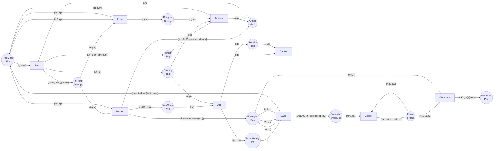

# Entanglement generation and swapping as a timed coloured Petri net

`qetwork.petri` models `protocols.e_dist_swap.EntanglementDistribution` (heralded link
generation, retry-until-success, as-ready swapping, one Pauli frame at the destination)
as a **timed coloured Petri net (TCPN)**. The net reproduces the event-driven simulator:
timing to the picosecond on lossless chains, and the same latency/attempt/fidelity
distributions on lossy ones (see [Validation](#validation)).

| module | role |
|---|---|
| `petri/tcpn.py` | generic TCPN kernel: places, timestamped coloured tokens, guarded transitions, delays, priorities, weighted conflicts, DOT/Mermaid export |
| `petri/entanglement.py` | the repeater-chain net (`build_net`, `simulate`) |
| `petri/params.py` | `NodeParams` / `EdgeParams` / `ChainParams`, `ChainParams.from_network(net, path)` |
| `petri/pair_state.py` | what a pair token carries: `DensityMatrix` (exact) or `BellDiagonal` (analytic) |
| `petri/bell.py` | Bell-diagonal algebra: Pauli channels and swaps as XOR-convolutions |
| `petri/validate.py` | cross-check against the simulator (CLI) |

```python
from qetwork.petri.entanglement import ChainParams, simulate
params = ChainParams.from_network(net)            # any materialized QuantumNetwork + path
r = simulate(params, mode="tad", seed=1)          # r.latency, r.fidelity, r.attempts, r.net
```

## Why each TCPN feature is needed

| feature | what it carries here |
|---|---|
| **colours** | node, edge, attempt generation and the pair's quantum state. One *folded* net serves every chain length: `K` appears only in the colour sets and the initial marking. |
| **time** (`@+d` on output arcs) | fiber flight `qd(i)`, classical delays `cd`, retry timeouts, BSM and correction durations. A token cannot be consumed before its timestamp. |
| **weights** (GSPN random switch) | photon survival: `Herald` and `Lose` share their preset and race with weights `surv(i)` and `1-surv(i)`. |
| **priorities** | same-tick ordering: arrivals (0) → state operations (10) → protocol decisions (20), mirroring `events/priority.py`. |

The places separate **physical** state (what memories and fibers hold) from **knowledge**
(what a node has learned through local heralds or classical messages). The gap between
them is what the protocol's timing is about. For example, a pair exists from the moment
of absorption, but its emitter knows it only one classical delay later.

## Net structure

Path `n_0 … n_K`. Edge `i` joins emitter `n_i` → absorber `n_{i+1}`. Each node has one
link memory per path side (`up` toward `n_0`, `down` toward `n_K`).

### Colour sets

| colour set | definition | meaning |
|---|---|---|
| `Slot` | Node × {up, down} | a link memory |
| `Arm` | Edge × Gen | emitter of edge `i`, `Gen` attempts made so far |
| `Attempt` | Edge × Gen × Time | one emitted pair (idler stored, emitted at `Time`) |
| `Tag` | Edge × Gen | control knowledge about attempt `(i, g)` |
| `Pair` | Node × Node × Time × Time × State | entangled pair: ends, per-half settle times, two-qubit state |
| `SwapBits` | Node × Bit × Bit | BSM outcome of interior node `r` |
| `Frame` | Int × Bit × Bit | destination's Pauli frame: swaps reported, XOR of bits |

### Places

| place | colour | kind | holds |
|---|---|---|---|
| `FreeMem` | Slot | physical | empty link memories |
| `Armed` | Arm | knowledge | emitter may fire its next attempt |
| `InFlight` | Attempt | physical | idler at `n_i`, signal photon in fiber `i` |
| `Dangling` | Attempt | physical | idler at `n_i` whose photon was lost |
| `Entangled` | Pair | physical | heralded pairs in memory (swaps merge them) |
| `Pending` | Tag | knowledge | emitter waits for `LINK_ACK` of attempt `g` |
| `Timer` | Tag | knowledge | emitter's retry timer for attempt `g` |
| `AckChan` | Tag | knowledge | `LINK_ACK` on the classical fiber `n_{i+1} → n_i` |
| `Receipt` | Tag | knowledge | emitter saw the ACK (retires the stale timer) |
| `DownReady` | int | knowledge | interior `n_r` knows its downstream link is up |
| `SwapMsg` | SwapBits | knowledge | `SWAP_RESULT` on the classical fiber `n_r → n_K` |
| `Frame` | Frame | knowledge | destination's frame accumulator |
| `Delivered` | Pair | physical | end-to-end pair after the frame correction |

### Transitions

| transition | consumes | produces | prio |
|---|---|---|---|
| `Emit` | `Armed(i,n)`, `FreeMem(i,down)` | `InFlight(i,n+1,now)@+qd(i)`, `Pending(i,n+1)`, `Timer(i,n+1)@+timeout(i)` | 20 |
| `Herald` *(w = surv(i))* | `InFlight(i,g,te)`, `FreeMem(i+1,up)` | `Entangled(i,i+1,te,now,raw(n_i))`, `AckChan(i,g)@+cd(i)` [, `Armed(i+1,0)` — sequential baton] | 0 |
| `Lose` *(w = 1−surv(i))* | `InFlight(i,g,te)`, `FreeMem(i+1,up)` | `Dangling(i,g,te)`, `FreeMem(i+1,up)` | 0 |
| `Ack` | `AckChan(i,g)`, `Pending(i,g)` | `Receipt(i,g)` [, `DownReady(i)` if `i > 0`] | 0 |
| `Timeout` | `Timer(i,g)`, `Pending(i,g)`, `Dangling(i,g,_)` | `Armed(i,g)`, `FreeMem(i,down)` | 20 |
| `Cancel` | `Timer(i,g)`, `Receipt(i,g)` | — | 20 |
| `Swap` | `DownReady(r)`, `Entangled(a,r)`, `Entangled(r,b)` | `Entangled(a,b)`, `SwapMsg(r,m1,m2)@+bsm(r)+cd(r,K)`, `FreeMem(r,up)@+bsm(r)`, `FreeMem(r,down)@+bsm(r)` | 10 |
| `Collect` | `SwapMsg(r,m1,m2)`, `Frame(n,a1,a2)` | `Frame(n+1, a1⊕m1, a2⊕m2)` | 0 |
| `Complete` | `Frame(K−1,a1,a2)`, `Entangled(0,K)` | `Delivered(0,K)@+corr` | 10 |

### Diagram

Generated by `build_net(params).to_mermaid()` (`to_dot()` gives Graphviz source).



### Modes

The modes differ only in the initial marking, the timeout, and whether `Herald` passes
the baton. This mirrors `RepeaterProtocol`.

| mode | initial `Armed` | `timeout(i)` | baton |
|---|---|---|---|
| sequential | `(0,0)@0` | `rtt(i)+1` | `Herald` on edge `i` arms edge `i+1` |
| parallel | `(i,0)@0` for every edge | `max rtt + 1` (shared round grid) | — |
| tad | `(i,0)@offset(i)` | `rtt(i)+1` | — |

`offset(i) = round(max_j E[T_j] − E[T_i])`, with `E[T] = rtt + (1/p − 1)(rtt + 1)`
(`e_dist_swap.expected_completion`).

## Properties

- **No inhibitor arcs are needed for the retry race.** A heralded attempt's ACK lands
  at `t_emit + rtt`, strictly before its timer (`rtt + 1`, or the round period ≥ that).
  So `Ack` consumes `Pending` first, and `Cancel` later retires the timer against
  `Receipt`. `Timeout` needs a `Dangling` token and so can only bind a lost attempt.
  `Receipt` is the complement place that replaces "fire only if no ACK".
- **Free-choice loss.** `Lose` returns the absorber's slot it reads, so `Herald` and
  `Lose` have identical presets. That makes it an extended-free-choice conflict, where
  GSPN weights are well defined.
- **Memory P-invariant.** For every link memory, exactly one of these holds: it is in
  `FreeMem`, it holds the idler of an `InFlight`/`Dangling` attempt, or it holds one end
  of an `Entangled`/`Delivered` pair. The net therefore cannot double-book a memory. The
  tests check this after every firing.
- **Clean termination.** Run past delivery to a dead marking, the net is left with one
  `Delivered` pair and all `2(K−1)` interior memories free. Every other place is empty:
  no stray timers, messages or knowledge.
- **Lazy decoherence.** As in `MemoryQubit`, each pair half carries the time it was last
  settled, and idle noise is applied only when a gate touches it (`Swap`, `Complete`).
  This is exact, because idle noise on one qubit commutes with operations on the others.

## The pair-state colour

Only `Pair.state` and five arc functions (`raw`, `idle`, `swap`, `correct`, `fidelity`)
depend on the physics model. The net structure is the same for both models.

| | `DensityMatrix` (default) | `BellDiagonal` |
|---|---|---|
| colour | 4×4 density matrix | 4 Pauli-frame probabilities (Φ+, Φ−, Ψ+, Ψ−) |
| evolution | the simulator's own `T1`/`T2`, `apply_gate`, `measure` on a scratch `StateTracker` | XOR-convolution on the Klein four-group |
| BSM bits | Born-sampled | uniform (exact for Bell-diagonal inputs) |
| exact for | everything qetwork models | Pauli noise: T2, depolarizing gates; T1 = ∞ |
| approximate | — | finite T1 (Pauli twirl; error grows quickly, so don't use it there) |
| refuses | — | source phase, coherent 1q / ZZ errors |

The Bell model makes the physics readable in closed form. The swap is `p ⊛ q`, the BSM
error is the Pauli channel `(1 − 4p₂/5, 4p₂/15, 4p₂/15, 4p₂/15) ⊛ (1 − 2p₁/3, 2p₁/3, 0, 0)`,
and the fidelity is `p[0]`. The tests check it against the density-matrix circuit. Use
`DensityMatrix` for the dataset CSVs: they have finite T1, random source phases and
coherent gate errors.

## Validation

```bash
uv run python -m qetwork.petri.validate                       # synthetic 20/35/10 km chain, all modes
uv run python -m qetwork.petri.validate --csv src/qetwork/input_dir/tester.csv --row 3
uv run pytest tests/test_petri.py
```

Each mode runs two checks:

- **Lossless.** Timing is deterministic, and latency and attempts must match on every
  run. Fidelity must match exactly when it doesn't depend on BSM outcomes, and
  statistically otherwise.
- **Lossy.** Mean ± SE for latency, attempts and fidelity, plus a KS test on latency.

Results at the time of writing (`|z|` = difference of means in standard errors):

| chain | runs | worst \|z\| | KS p (min) |
|---|---|---|---|
| synthetic 20/35/10 km, all modes | 1000 | 1.26 | 0.425 |
| same, finite T1 = 2 ms (sequential) | 1000 | 1.83 | 0.235 |
| `tester.csv` row 3 (21 nodes; T1, phases, coherent errors), seq/par | 2000 | 1.54 | 0.431 |

On the lossless chains, the latency and attempts were identical on every run in every case.

## Extending the net

- **Cutoffs.** On `Herald`, add a `Cutoff(pair id)@+τ` token. A `Discard` transition
  consumes `Cutoff` + `Entangled` and frees both slots. A `Swap` that wins the race
  produces a `Receipt`-style complement that retires the cutoff, which is the same
  pattern as `Timer`/`Cancel`.
- **Multiplexing.** Add a memory index to `Slot` and put `m` tokens per side in
  `FreeMem`. `Emit` already draws any free slot, and attempt generations keep the races
  apart.
- **Purification (`LinkPumpSession`).** This is a subnet between `Herald` and `Swap`.
  Two `Entangled(i,i+1)` tokens go to a `Purify` transition with weight `p_keep`,
  `PURIFY_BIT`/`PURIFY_VERDICT` messages go on knowledge places, and the level counter
  goes in the pair colour.
- **Analysis.** Structural properties can be checked on the same object. P-invariants
  are already in the tests. For reachability or state-space exploration of the
  untimed skeleton, export with `to_dot()` or re-encode the tables above in CPN Tools.
